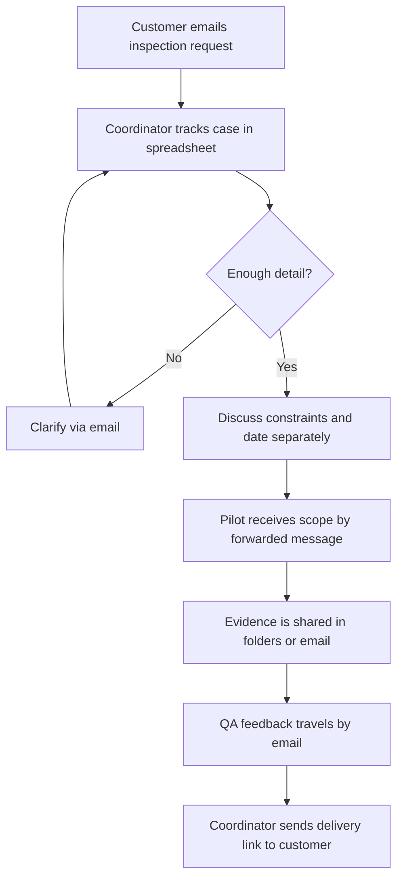

# AS-IS Process – Illustrative Current State

**Evidence:** Entirely invented current-state example; not based on observation or materials from a real organization.

See [process analysis](../04_process_analysis.md).
