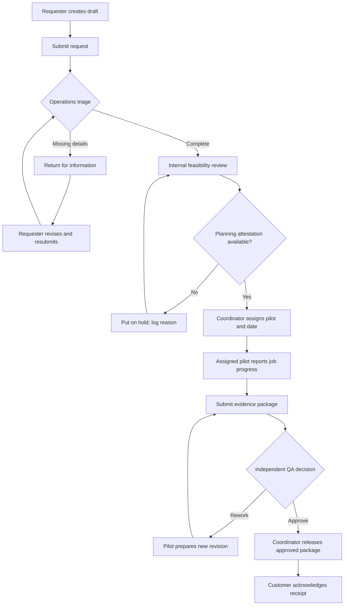

# TO-BE Process – Proposed Customer-to-Delivery Flow

**Safety boundary:** The internal planning attestation shown here is not legal or operational permission to fly. Actual flight-readiness checks and aviation decisions are outside this digital product concept.

**Status:** design candidate, not a validated or implemented workflow. Cancellation, changed constraints and exceptions are detailed in [status model](../07_workflow_and_status_model.md).
