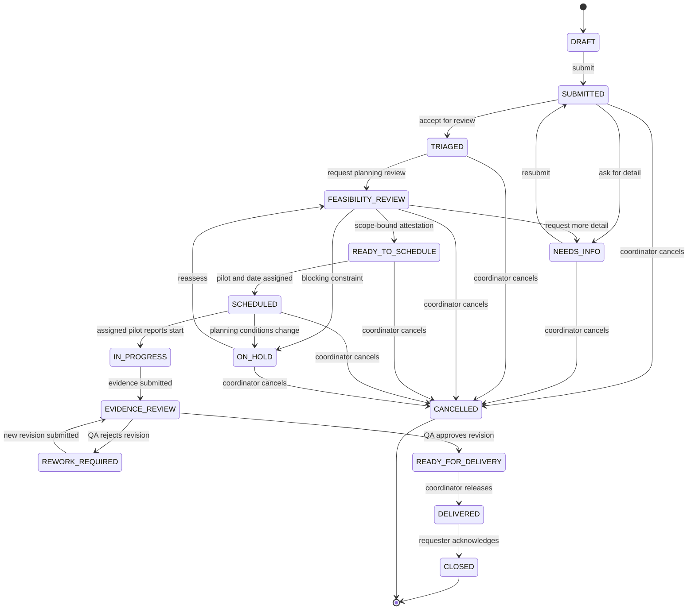

# Request Lifecycle – Proposed State Machine

**Status:** entirely hypothetical workflow. `READY_TO_SCHEDULE` is an internal planning checkpoint and does not authorize any real flight.

See [status and transition table](../07_workflow_and_status_model.md) for actors, guards and scope-version constraints.
