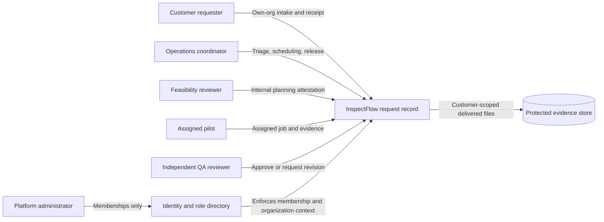

# Actor and Information Boundaries – Proposed Design

**Proposed controls:** customer requesters see only their organization, pilots only assigned work, admins no request content by default, and release is gated by independent QA.

**Not shown as integrations:** aircraft systems, airspace services, flight control, regulations, payments or a public service-provider marketplace.

See [role permissions](../06_business_rules_and_permissions.md).
